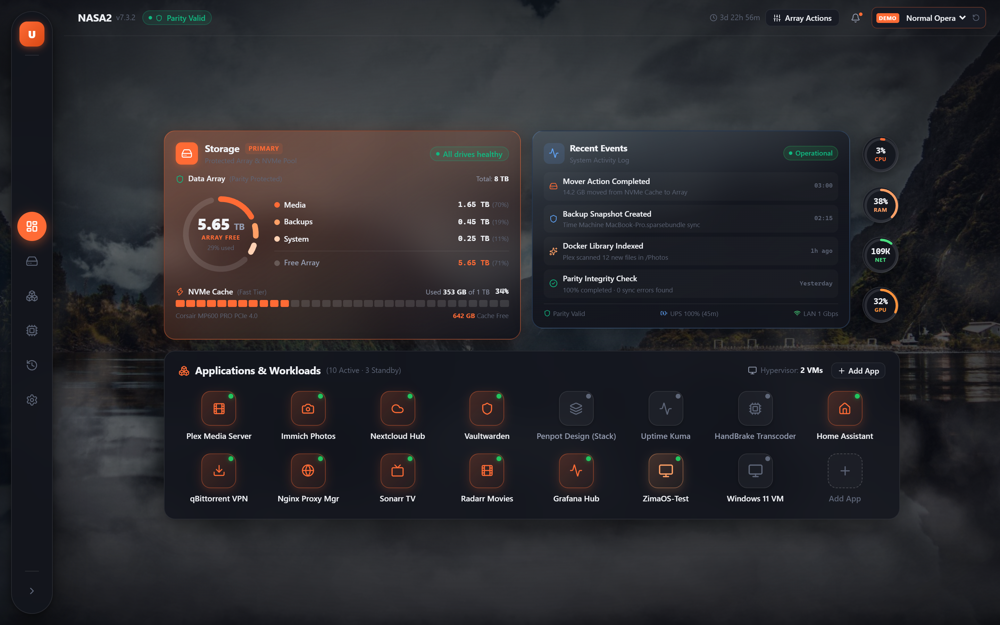
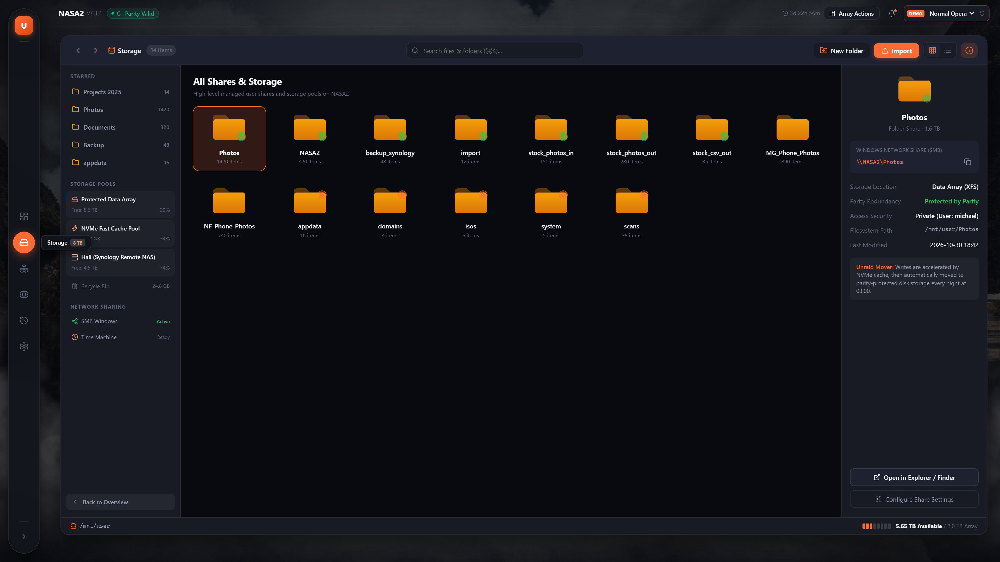

# Unraid Next Dashboard `v0.0.1`

> **A radical reimagining of the Unraid WebGUI — Minimalist, Atmospheric, and Human-Centric.**

[](https://github.com)
[](https://react.dev/)
[](https://www.typescriptlang.org/)
[](https://vitejs.dev/)
[](#design-philosophy)
[](LICENSE)

---



---

## 📖 Vision & Overview

Traditional NAS management interfaces, including Unraid's legacy WebGUI, are often engineered around raw Linux mount points, sprawling hardware tables, and overloaded telemetry dials. While powerful, this layout can quickly feel like an intimidating cockpit of technical minutiae.

**Unraid Next Dashboard** reimagines the home server experience from the ground up:
- **Storage & Workloads First**: The primary reason users run Unraid is redundant storage and Docker application services. These take the center stage.
- **Calm, Focused Telemetry**: CPU, RAM, Network, and GPU telemetry are condensed into **4 ultra-compact circular micro-widgets** — 3× more compact than traditional bulky cards, with deep stats available on hover or click.
- **Atmospheric Living Backdrop**: A serene Norwegian mountain fjord featuring continuous CSS3 drifting fog layers inspired by [CodePen QWbpqwR](https://codepen.io/animationbro/pen/QWbpqwR).
- **Zero-Scroll Ergonomics**: The entire dashboard fits cleanly on a single screen without vertical scrolling across desktop resolutions (1366×768, 1440×900, 1920×1080).

---

## ✨ Key Features

### 1. 🌄 Atmospheric Mountain & Fog Backdrop
- Pure CSS3/GPU-accelerated background with photographic fjord landscape (*Antoine Barrès*).
- Multi-layered drifting low mist (`fog-low.png`) and moving clouds (`clouds.png`) with seamless `cloudLoop 80s` keyframes.
- Cinematic radial vignette and ambient darkness ensuring crystal-clear text readability and high contrast.

### 2. 🏝 Centered Workstation Island
- Workstation elements sit gracefully in the middle of the screen (`max-width: 1060px`), surrounded by negative space and living scenery.
- Elevated dark frosted glass surfaces (`rgba(18, 20, 28, 0.85)` + `backdrop-filter: blur(24px)`).

### 3. 💊 Floating Stadium Capsule Dock
- Side navigation floats detached from viewport edges with a `16px` margin (`border-radius: 36px`).
- Active items highlighted by a distinct illuminated circular pill in Unraid Orange (`#ff6b35`).
- Smooth hover tooltips and 1-click expansion into a full info card.

### 4. 🟠 Storage Hero Card (Orange Glass)
- Warm orange glass container highlighting Unraid's core strength: **Protected Data Array & Fast NVMe Tier**.
- Circular multi-segmented donut ring with prominent free space display (`5.65 TB FREE`).
- Categorized allocation legend (`Media: 1.65 TB`, `Backups: 0.45 TB`, `System: 0.25 TB`).
- Dedicated segmented NVMe Cache progress bar.

### 5. ⚡ Recent Events & Server Health Card
- Live activity feed showing scheduled Mover executions, Time Machine backups, Plex library scans, and monthly parity integrity checks.
- Quick system status chips: `Parity Valid`, `UPS 100% (45m)`, `LAN 1 Gbps`.

### 6. 🔘 Ultra-Compact Circular Telemetry (3× More Compact)
- 4 sleek 52px circular micro-gauges vertically stacked:
  - **CPU**: Load percentage ring + 31°C flame indicator.
  - **RAM**: Memory utilization ring (16 GB DDR5).
  - **NET**: Real-time throughput (inbound/outbound speeds).
  - **GPU**: VRAM allocation ring (RTX 3060 NVENC engine).
- Detailed tooltips appear on hover with clock speeds, fan RPMs, and transcoding statuses; clicking opens the deep telemetry slide-over drawer.

### 7. 🚀 Applications & Workloads Launcher Dock
- Clean 8×2 launcher grid of 50×50px squircles (macOS Launchpad / iPad style).
- Running status indicators and full untruncated app names (`Plex Media Server`, `Immich Photos`, `Home Assistant`, etc.).
- Filter chips and 1-click WebUI simulation.

### 8. 📁 Modern Storage File Manager
- Replaces Unraid's raw shares table with an intuitive file manager (macOS Finder / Windows Explorer feel).
- Starred quick access, storage pool filtering, interactive breadcrumbs, live search (`⌘K`).
- 1-click UNC network paths (`\\NASA2\Photos`) and plain-English Mover caching explanations.



---

## 🛠 Tech Stack

- **Framework**: [React 19](https://react.dev/) + [TypeScript](https://www.typescriptlang.org/)
- **Bundler & Tooling**: [Vite 8](https://vitejs.dev/)
- **Iconography**: [Lucide React](https://lucide.dev/)
- **Styling Architecture**: Pure CSS Tokens, Material Design 3 elevation shadows, VisionOS-style frosted glass (`backdrop-filter: blur(24px)`), CSS3 GPU `@keyframes` animations.

---

## 🚀 Quick Start

### Prerequisites
- [Node.js](https://nodejs.org/) v18.0.0 or later
- npm v9+

### Installation & Run

```bash
# 1. Clone repository
git clone https://github.com/michaelgubert-ai/unraid-next-dashboard.git
cd unraid-next-dashboard/prototype

# 2. Install dependencies
npm install

# 3. Start development server
npm run dev
```

Open your browser at `http://localhost:3000` to interact with the dashboard.

### Production Build

```bash
cd prototype
npm run build
npm run preview
```

---

## 🎛 Interactive Demo Scenarios

The prototype includes an interactive scenario switcher located in the top header (`DEMO` menu) to test UI reactivity under real server conditions:

| Scenario | Description |
| :--- | :--- |
| **Normal Operation** | All 6 data disks healthy, parity valid, workloads operational. |
| **Degraded Disk Alert** | Simulates Disk 1 failure (SMART errors, amber warning badge, degraded status). |
| **Parity Check Active** | Shows live progress bar for 12 TB parity recalculation. |
| **Cached / Offline Mode** | Simulates disconnected or stale server telemetry. |

---

## 📁 Repository Structure

```
Unraid-v1-Dashboard/
├── docs/
│   └── screenshots/               # Full-resolution presentation screenshots
│       ├── overview_1440x900.png
│       ├── overview_1920x1080.png
│       ├── sidebar_expanded.png
│       └── storage_file_manager.png
├── prototype/
│   ├── public/                    # Assets: mountains, fog, clouds, icons
│   │   ├── antoine-barres.jpg
│   │   ├── clouds.png
│   │   └── fog-low.png
│   ├── src/
│   │   ├── components/
│   │   │   ├── details/           # Slide-over drawers (App, Disk, Resources)
│   │   │   ├── layout/            # Sidebar, Header, FogBackground, MobileNav
│   │   │   ├── overview/          # StorageHeroCard, RecentEventsCard, CircularTelemetryCol, AppsGridSection
│   │   │   ├── storage/           # StorageSharesView (Modern File Manager)
│   │   │   └── ui/                # Badge, ProgressBar, Toast
│   │   ├── context/               # Server state & scenario simulation context
│   │   ├── mock/                  # Authentic Unraid NASA2 mock datasets
│   │   ├── styles/                # tokens.css, components.css, global.css
│   │   ├── types/                 # TypeScript data contracts
│   │   └── App.tsx                # Main application orchestrator
│   ├── package.json
│   ├── tsconfig.json
│   └── vite.config.ts
├── .gitignore
└── README.md
```

---

## 📝 Release Notes `v0.0.1`

### What's New in Initial Release
- **Initial prototype architecture**: Vite + React 19 + TypeScript.
- **Centered Workstation Layout**: Clean island arrangement matching user design specification.
- **Atmospheric Background**: Integrated CodePen `QWbpqwR` mountain fjord and looping cloud/fog animation.
- **Orange Storage Box**: Segmented donut ring with 5.65 TB free space and NVMe Cache tier.
- **Recent Events Card**: System activity feed and health indicators.
- **3× Compact Telemetry**: 4 circular micro-gauges (CPU, RAM, Network, GPU) with hover inspection.
- **Floating Capsule Dock**: Detached stadium pill side navigation with Pierre Sù active glow.
- **Storage File Manager**: macOS Finder / Windows Explorer shares view with UNC path copy.

---

## 📄 License

This project is licensed under the [MIT License](LICENSE).
Unraid is a registered trademark of Lime Technology, Inc. This project is an independent community UI/UX design exploration.
